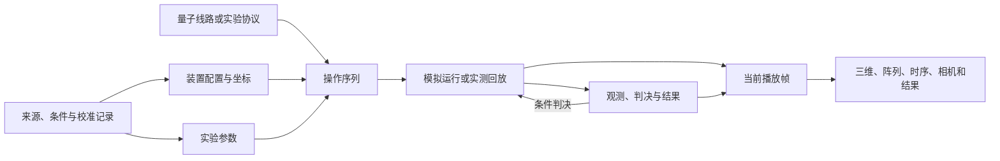

# 整机数字孪生模型的接口与验收

现有整机以 `createMachineRun` 生成固定种子的理想线路和合成结果，以 `machineFrame` 同步代表轮、位点、光路、门和批次统计。新版可沿用这条数据流，把演示中写死的网格、阶段时间和设备描述提升为可追溯的配置。真实装置资料、运行输入、实际或模拟结果和画面帧各有所有者。 [当前架构](../../docs/ARCHITECTURE.md) · [当前模型](../../src/physics/quantumComputer.ts)

## 对象、数据流和证据

| 对象 | 最少要表达的内容 | 验收 |
| --- | --- | --- |
| 装置配置 | 装置 ID 和版本、同位素、编码、基底位标、实验坐标系、各位点及功能区、光源及用途、成像通道和可用操作。机械示意与微米级测量可各有坐标层。 | 同一个位点能在阵列和三维中定位。切换装置记录时，阱、门或读出参数能随配置切换，未知尺寸显示为未提供或示意。容量、启用位点和本次使用位点分别统计。 |
| 证据／校准 | 对每个可进入模型的物理量记录数值、单位、误差定义、同位素、电子态和超精细标签、偏振和场、装置版本及图节。定义证据类型为实验测量、图表源数据、拟合／反演、理论、说明书或演示假设。 | 同名 532 nm 记录能区分光镊、局域失谐及输运晶格。缺失值和真实零值保持可区分。能查到参数来自哪里，在哪个适用条件下可复用。 |
| 运行序列 | 逻辑层记录门与测量基，装置层记录实现所需的目标位点、脉冲、移动和资源占用，包含前置条件或探测后的分支。 | 同一逻辑门可展开为候选装置各自定义的动作。带循环的协议可记录每轮和每次实际分支，序列事件可在时间轴单独检查。 |
| 运行记录与判决 | 绑定配置／校准版本和序列、运行模式、种子或来源、运行分支、逐次状态。观测保留原图或合成计数及曝光定义。判决保留阈值／算法、条件事件与观测引用。 | 从原位点和原子 ID 追踪一轮，能重现决策来源。曝光时间、判决结束和条件执行时间可分别检查，擦除发现允许晚于实际损失。 |
| 播放帧和导出 | 同一快照为 3D、2D、相机、曲线和线路提供时刻、显示事件、位点以及代表轮状态。导出记录模型／配置／文件格式版本、结果口径与来源。 | 播放、暂停和随机跳转读到同一物理状态，不同播放速度产生同一运行结果。旧深链接和旧版 JSON 可用原有语义识别。 |

装置与序列的分离可参照 NAViz 与 Pulser，时钟和事件采集参考 ARTIQ，原始数据与分析结果的关联参考 Qiskit Experiments，装置与校准快照参考 LabOne Q。 [NAViz 文件格式](https://mqt.readthedocs.io/projects/naviz/en/stable/file_format.html) · [Pulser](https://docs.pasqal.com/pulser/sequence/) · [ARTIQ RTIO](https://m-labs.hk/artiq/manual/rtio.html) · [Qiskit ExperimentData](https://qiskit-community.github.io/qiskit-experiments/stubs/qiskit_experiments.framework.ExperimentData.html) · [LabOne Q](https://docs.zhinst.com/labone_q_user_manual/getting_started/introduction.html)

## 把资料用于建模与测试

| 模块 | 模型约束和来源 | 可测试的最小行为 |
| --- | --- | --- |
| 原子供给、装载和重排 | 对每轮记录装载或复用。分别记录目标位点数、单点占据、满阵列、搬运存活。重复补填与每轮重新装载是不同协议。 [Norcia 图 1–3](../library/171yb/yb-norcia-assembly.pdf) · [Barredo 图 1–3](../library/neutral-atoms/na-barredo2016.pdf) · [Li 图 1、3–4](../library/171yb/yb-li-reloading.pdf) | 给定初始占位和种子，可重放装配。原子身份在搬运中连续，补位可引入新原子身份。按全部尝试计算装配完成率，同时保留逐位点统计。 |
| 空间输运、换阱和态转移 | 轨迹改变物理坐标，同址换阱改变势阱归属和功率，态转移改变内部态。三者有独立事件和目标。真实搬运时间需有按该装置测量或调度的依据。 [Muniz 附录 A](../library/171yb/yb-muniz-gates.pdf) · [五区配置图 1](../library/171yb/yb-muniz-ancilla.pdf) · [Lis 图 1、附录 B](../library/171yb/yb-lis-omg.pdf) | AOD 移动连续更新坐标。换阱时同一个原子留在同一位点，两个阱通道可在相同区间同时活跃。内部态转移更新能级视图。 |
| 装置寻址和并行约束 | 门可在固定阱间逐址执行，AOD 搬运可受共享行列及先后约束，SLM 也可在同一次图案更新中移动多个阱。每类装置记录受控资源。 [Radnaev 图 1、5](../library/neutral-atoms/na-radnaev2025.pdf) · [Stade、Wille 第三节](../library/neutral-atoms/na-stade2026-naviz.pdf) · [Lin 图 1–4](../library/neutral-atoms/na-lin2025.pdf) | 静止逐址只改变通道状态。并行动作按目标、光路、阱轨迹和装置能力检查资源冲突。 |
| 光阱、场和能级 | 激光通道注明波长、原子处功率口径、束腰、偏振、时间包络、作用位点及证据。原子能级引用电子态、同位素和超精细条件。旁轴高斯和标量极化率分别记录近似范围。 [Kroeze 原子参考](../library/171yb/yb-kroeze-reference.pdf) · [Höhn 条件模型](../library/171yb/yb-hohn-potentials-publisher.pdf) · [Peper 光谱和 MQDT](../library/171yb/yb-peper-mqdt-publisher.pdf) | 同一个计算快照驱动位点的势阱、光移、频率显示和演化。频率 Hz 与角频率 rad/s 在边界明确换算。用同位素一致的标定数据时，校准参数和预测都可追溯。 |
| 相互作用和门动力学 | 先保持 H、CZ 等理想线路语义。装置级门以实现路线注明脉冲、占据子空间、位点对、磁场与相对取向。`C₆/r⁶` 作为特定范德瓦耳斯近似，Förster 共振、态混合和本征曲线路径各有适用范围。 [Muniz 图 3](../library/171yb/yb-muniz-gates.pdf) · [Peper 正文及模型](../library/171yb/yb-peper-mqdt-publisher.pdf) · [Ravets](../library/neutral-atoms/na-ravets-forster.pdf) · [Senoo 扩展数据图 5](source-data.md) | 理想 Bell／GHZ 按现有 Z、X 基参考验证。用近似模型时检查距离和角度依赖是否适用于指定支系。门光路示意与理想逻辑结果可各自验证。 |
| 相机、丢失和擦除 | 保留从真实物理状态、原始计数或合成观测到分类的映射。装配空位、探测暗态、原子丢失、泄漏子空间和标记擦除按实验可分辨范围表达。生存后选、读出校正和全部尝试各有分母及来源。 [Muniz 附录 A](../library/171yb/yb-muniz-gates.pdf) · [Ma 图 1–4](../library/171yb/yb-ma-metastable-publisher.pdf) · [Senoo 图 2 源表](source-data.md) · [Bluvstein 扩展数据图 3](../library/neutral-atoms/na-bluvstein2026-ft.pdf) | 两帧数据能同位置回放。单帧暗位点保留其可判别范围，后续观测驱动判决。原始、后选和纠正后的统计有各自标记和误差。 |
| 实时控制与反馈 | 保留序列时间、执行时标和网页播放时间。采集、传输、阈值／解码、发出条件动作都可记录事件。控制器能力、排队和实验发生的延迟分别记录。 [五区配置图 1、附录 B](../library/171yb/yb-muniz-ancilla.pdf) · [Google 量子纠错，图 4](../library/superconducting/xp-willow.pdf) · [QCCD 图 1](../library/trapped-ions/xp-qccd.pdf) | 用离线记录观察条件分支是否只在观测到达后触发。改变播放速度不改变记录中的顺序与时间关系。 |
| 验证与误差传播 | 分开使用计算不变量、文献图源对比、同装置留出数据。记录每次实验点的条件、误差条种类、批次与选择口径。数值拟合及交叉装置比较的证据等级分别登记。 [Senoo 源表](source-data.md) · [Kroeze 冷却](../library/171yb/yb-kroeze-cooling.pdf) · [现有验收](../../docs/VALIDATION.md) | 单元测试验证概率归一、状态和计数一致性。用图源表检验读出图与导入接口。使用同一装置、独立工作点和报告的不确定度验证物理预测。 |

## 实现次序

1. **先建立与装置无关的操作和证据接口。** 使用现有示意模型作为回归样本。验证同一种子的原有统计、旧深链接、现有浏览器显示和导出。
2. **选型后建立一套具名的装置与流程。** 确定该装置能支持的运行协议、示意范围和实测边界。让源图、装置坐标、播放事件和观测判决互相对应。
3. **接入可追溯的局部实测。** 从占位和读出的离线数据开始，再引入阱、门和反馈记录。只有同装置数据可用于标定该装置。跨平台和不同同位素材料可用于接口、极限和模型对照。

若后续需要展示模拟量子处理，可在序列层保留连续的幅度、失谐和相位波形，输出空间关联与指定观测量。数字逻辑门和连续哈密顿量在运行记录中有明确模式，方便同一装置视图复用状态查询和显示。 [Bernien 图 1–4](../library/neutral-atoms/na-bernien2017.pdf) · [Ebadi 图 1–4](../library/neutral-atoms/na-ebadi2021.pdf)
